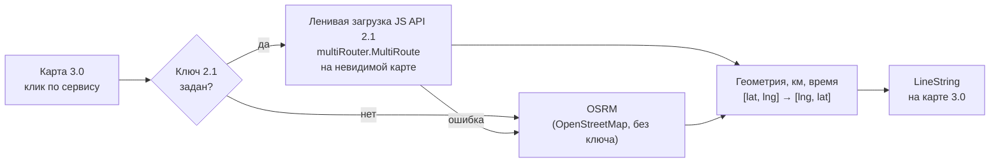

# Автосервисы на карте

**Интерактивная карта автосервисов на Nuxt 4 + Яндекс.Картах JS API 3.0**
кластеры · тултипы · геолокация · маршрут до сервиса

🔗 **Демо:** [map-autoservice.dmitriyburlak.ru](https://map-autoservice.dmitriyburlak.ru)

[](https://nuxt.com)
[](https://vuejs.org)
[](https://www.typescriptlang.org)
[](https://tailwindcss.com)
[](https://yandex.ru/maps-api/docs/js-api/)
[](https://vitest.dev)
[](https://nodejs.org)

[Возможности](#-возможности) ·
[Стек](#-стек) ·
[Как устроено](#-как-устроено) ·
[Запуск](#-запуск) ·
[Docker и деплой](#-docker-и-деплой)

> Interactive map demo on **Nuxt 4 + Yandex Maps JS API 3.0**: random autoservice points, clustering,
> rich hover tooltips, geolocation and driving routes from the user to a service.

Демо-приложение, показывающее работу с Яндекс.Картами во Vue/Nuxt: на карте случайно генерируются
автосервисы, при наведении — тултип с рейтингом и информацией, по клику — карточка, а от вашего
местоположения до сервиса строится автомаршрут с расстоянием и временем в пути.

---

## ✨ Возможности

- 🚗 **Маршрут до сервиса** — реальный автомаршрут с расстоянием и временем в пути
- 🧭 **Геолокация** — метка «Я», которую можно перетащить; маршрут пересчитывается
- 📍 **Кластеры** — сервисы по одному адресу схлопываются в пин со счётчиком
- 💬 **Тултипы и карточка** — рейтинг, отзывы, статус «открыто сейчас», услуги, цена
- 🔎 **Фильтры и сортировка** — состояние хранится в URL, ссылкой можно поделиться
- 📱 **Адаптив** — на мобильных карточка снизу, список и фильтры в шторке

## 🧰 Стек

| Слой | Технологии |
|---|---|
| Фреймворк | Nuxt 4 (SPA, `ssr: false`), Vue 3.5, TypeScript |
| UI | Nuxt UI 4, Tailwind CSS 4, Lucide icons |
| Карты | [vue-yandex-maps](https://github.com/yandex-maps-unofficial/vue-yandex-maps) (JS API 3.0), JS API 2.1 / [OSRM](https://project-osrm.org/) для маршрутов |
| Качество | Vitest, ESLint, vue-tsc |
| Инфраструктура | Docker (multi-stage), GitLab CI |

## 🏗 Как устроено

### Маршрут: JS API 2.1 внутри карты 3.0

В JS API 3.0 нет маршрутизатора, поэтому `buildYandexRoute` идёт в обход:



Гонки запросов при перетаскивании метки отсекаются через `AbortController` и сверку ключа точек.

### Архитектура (Feature-Sliced Design)

```
app/src/
├─ 1_pages/map-page/          страница: композиция виджетов, URL-состояние, «живая карта»
├─ 2_widgets/
│  ├─ autoservices-map/       карта: маркеры, кластеры, тултипы, метка «Я»
│  └─ autoservices-list/      боковой список
├─ 3_features/
│  ├─ map-filters/            фильтры и сортировка (чистая функция applyFilters)
│  ├─ route-to-service/       маршрут «я → сервис»
│  └─ user-location/          геолокация
├─ 4_entities/autoservice/    модель, генератор, график работы, тултипы, карточка
└─ 5_shared/
   ├─ lib/                    geo (haversine), группировка по координатам, PRNG, форматтеры
   └─ ui/yandex-map/          обёртка над картой, пины, маршрутизация (Яндекс 2.1 / OSRM)
```

> [!TIP]
> Слой `5_shared/ui/yandex-map` не знает про автосервисы: `YMap` типизирован дженериком по маркеру
> и отдаёт его в слот, так что тот же компонент подходит для любых точек.

## 🚀 Запуск

**Требования:** Node.js ≥ 22.14 и pnpm 10.

```bash
pnpm install
cp .env.example .env   # и впишите ключи
pnpm dev               # http://localhost:3000
```

### 🔑 Ключи Яндекс.Карт

В [кабинете разработчика](https://developer.tech.yandex.ru/services) получите ключ
**JavaScript API и HTTP Геокодер**:

| Переменная | Зачем | Обязательна |
|---|---|:---:|
| `NUXT_PUBLIC_YANDEX_MAPS_APIKEY` | карта (JS API 3.0) | ✅ |
| `NUXT_PUBLIC_YMAPS2_APIKEY` | маршруты через Яндекс (JS API 2.1) | — без него OSRM |

Можно указать один и тот же ключ в обе переменные.

> [!WARNING]
> Ключ попадает в клиентский бандл — в настройках ключа **ограничьте его по HTTP Referer**
> (`localhost` и домен деплоя).

### 📜 Скрипты

| Команда | Что делает |
|---|---|
| `pnpm dev` | дев-сервер |
| `pnpm build` | production-сборка (Node-сервер в `.output`) |
| `pnpm generate` | статическая сборка в `.output/public` |
| `pnpm lint` / `pnpm lint:fix` | ESLint |
| `pnpm typecheck` | проверка типов (vue-tsc) |


Все автосервисы, адреса, телефоны и отзывы **вымышлены** и генерируются случайно.
